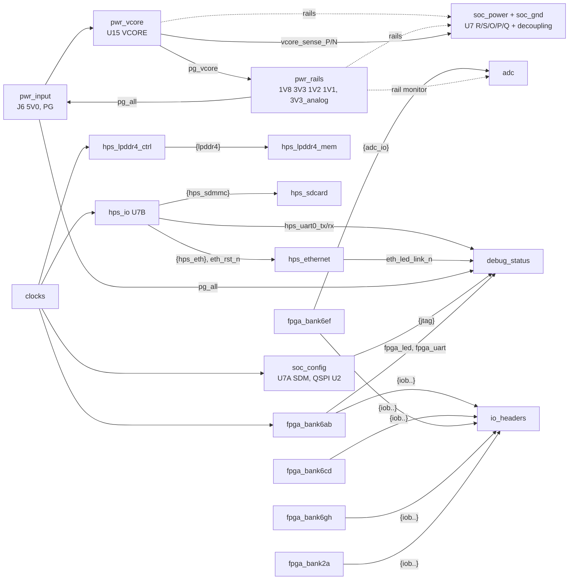

# Schematic reorganisation plan

Plan for making the schematic readable again without breaking the PCB, which is mostly routed. Based on the schematic as of 2026-10-23 (commit af68458 + working copy), KiCad 10.0.7. All numbers below come from `kicad-cli` exports (netlist, ERC JSON, PDF) and from parsing the `.kicad_sch` files directly.

Legend: **[net]** = the step renames nets (shows up as PCB net renames, which is fine but has to be checked), **[cosmetic]** = no electrical change, **[moves]** = symbols change sheet (risk to footprint links, see §4.1).

Baseline to compare every step against:

| Metric | Value |
|---|---|
| Sheets | 18 (root + 17 sub-sheets), root A3, all others A4 |
| Parts (excl. power symbols) | 305 |
| Nets | 566 (189 `unconnected-(…)`, 54 auto `Net-(…)`, 19 global, 304 sheet-local) |
| ERC | 337: 136 isolated_pin_label, 60 unconnected_wire_endpoint, 44 similar_label_and_power, 24 endpoint_off_grid, 21 multiple_net_names, 16 label_dangling, 13 wire_dangling, 9 net_not_bus_member, 7 power_pin_not_driven, 4 pin_not_connected, 2 same_local_global_label, 1 hier_label_mismatch |
| PCB DRC `--schematic-parity` | 0 parity issues, 14 unconnected items, 46 violations |

---

## 1. What makes it hard to read (with evidence)

### 1.1 Sheet names don't match their content

| Sheet (file) | Name suggests | Actually contains |
|---|---|---|
| root `agilex_3_soc` | block diagram | 21 parts: **J3** 2x19 and **J5** 1x14 FPGA I/O headers, **U1** JTAG level shifter + **J1**, **U42** UART/LED/PG level shifter + **J10**, **J2** FPGA UART header + R47/R48, **J6/J4** 5 V input, **U6** NCP163 3V3_analog LDO, ADC rail-monitor dividers **R5, R42, R46, R51, R53, R54**, plus 62 bus segments, 70 bus entries and 81 local label names |
| Connectors `connectors` | the connectors | **no parts at all**: 11 hierarchical bus labels and a German note "MIPI Stecker auf das Modul?". It is only a bus hub, yet because its labels win the naming priority, **154 nets are called `/Connectors/…`** – including the Ethernet MDI pairs `/Connectors/txrxa_P` … whose jack J9 sits on the Ethernet sheet |
| power supply `ps` | power supply | U15 VCORE buck **and** 28 U7 VCORE decoupling caps C129–C156, plus an unrelated reference-design table "not relevant for this power" (R1205/R1201) |
| power supply1 `ps1` | ? | U18/U8/U19/U16 bucks, the power-good wired-AND, **and** 40 U7 decoupling caps (C170–C221) for 1V8/3V3/1V2/1V1 |
| FPGA power `fpga_power` | SoC power incl. decoupling | U7 units R/S only, **one** cap (C102); its decoupling lives on `ps`/`ps1` |
| SDM `sdm` | configuration | also the **QSPI flash U2** and the **power-good LED D1 / user LED D2** (driven from root and bank 6B through global labels) |
| HPS `hps` | HPS | U7 unit B **and** the complete microSD subsystem (J8, U11, U40, U41, C240–C248) |
| IOBANK 3 `iobank3` | bank 3A | LPDDR4 pins plus a leftover **HyperBus** interface (`hb*` labels, `{hyperbus}` sheet pin unconnected on root) |
| lpddr4 memory `mem1` | LPDDR4 | fine, but name `mem1` is a leftover |
| IOBANK 2 `iobank2` | bank 2A | plus a pasted MIPI lane table from DBM_A5E013 |

The power tree is spread across four places: root (U6), `ps` (U15), `ps1` (four bucks + PG chain), `fpga_power` (consumer pins). Decoupling for U7 is on the regulator sheets, decoupling for everything else sits next to its IC – two different conventions.

### 1.2 Connectivity by labels and "back-door" globals

- 561 local label instances, 60 hierarchical labels, 24 global label instances (15 names), 148 no-connect flags, ~2150 wire segments.
- Global labels are used as back-door wires between specific sheets instead of sheet pins: `fpga_led` (bank 6B -> SDM), `pg_led` (root -> SDM), `eth_rst_n` (HPS -> Ethernet), `eth_led1_n`/`eth_led_g_n` (Ethernet <-> root), `hps_uart0_tx/rx` (HPS -> root), `pg_all` (root/Ethernet, local in ps1), `sdm_clk25` (global on root + bank 6A, *hierarchical* on SDM, *local* in bank 6A – ERC `same_local_global_label`), `5V0` (global label in `ps` next to hierarchical label `5V`). `UART_TX`/`UART_RX` are global labels used only on the root sheet.
- The FPGA header connectivity is a three-hop bus fabric: bank sheet -> bus on root -> empty Connectors sheet / bus entries -> root local labels `iob6xN` -> J3/J5. Nine `net_not_bus_member` warnings show labels that are drawn on a bus they are not members of (e.g. `ad_SCLK` on the `{iob6f}` bus).
- **136 isolated labels**: U7 I/O pins that carry a label (and are drawn onto a bus) but go nowhere: `iob_2aB*` 26, `iob6a*` 19, `iob6e*` 19, `iob6d*` 14, `iob6g*` 9, `sd_d4..7` 8 (8-bit eMMC leftover on a 4-bit SD card), `hb*` 14 (HyperBus), `i2c_sda/scl`, `clk100`, `clk2_N`, `pwr_scl`. They look connected but are not – the most misleading thing in the schematic.
- 54 nets have no name at all, e.g. the JTAG header J1 (`Net-(J1-Pin_1)` … `Net-(J1-Pin_4)`) and the RGMII clock nets on the PHY side (`Net-(U10-GTX_CLK)`, `Net-(U10-RX_CLK/PHYAD2)`).

### 1.3 Inconsistent and duplicated net names

21 `multiple_net_names` warnings = one wire, two names. Examples:

| Wire | Names on it |
|---|---|
| power-good chain | `PG` / `pg_all` (ps1), `pg_1v8` / `pg_all` (root), `powergood` / `pg_led` (root), `PG-Core` (ps). Six names for two signals |
| HPS cold reset | `~{hps_cold_rstn}` (SDM local) vs `~{hpscold_rstn}` (SDM hierarchical + root stub) |
| PHY LED | global `eth_led1_n` on the wire labelled `phy_led2` |
| 5 V | hierarchical `5V` (ps, ps1) vs `5V0` (everywhere else) |
| ADC | `ad_CS`/`iob6f6`, `ad_SCLK`/`iob6f7`, `ad_SDO`/`iob6f3`, `admux_0..2`/`iob6f8, iob6f9, iob6b5` (root) |
| FPGA UART | `UART_TX`/`iob6b11`, `UART_RX`/`iob6b8` |
| bank 6G | `pwr_scl`/`iob6g4`, `pwr_sda`/`iob6g5` (hierarchical labels to dangling `scl`/`sda` stubs in ps1) |
| power pins | `vccio_6b`, `vccadc`, `vccplldigsdm`, `vccpllhps`, `vccplldighps`, `vccio_6a/6c/6x` local labels sitting on `3V3`/`1V8`/`VCORE` wires (fpga_power) |
| HPS osc clock | `clk1_P` (clock) -> `osc_clk_25` (root) -> `hps_osc_clk25` (HPS) |
| LPDDR4 refclk | `clk3_P/N` (clock) -> `iob3A_refclk_P/N` (root, bank 3) |

Style is mixed within one interface: `qspi_D0`, `qspi_CLK`, `~{qspi_CS}`, `~{qspi_rst_n}` (upper/lower case, overbar *and* `_n`); `ad_CS` vs `admux_0`; `iob_2aB5` vs `iob6a5`; `VICM_REFCLK` vs `vcoresense_P`. The orphan hierarchical label `1v8` in `fpga_power` alone causes 44 `similar_label_and_power` warnings plus one `hier_label_mismatch`.

### 1.4 Power symbols

No proper per-rail symbols are used: 109 power symbols are `power:+1V1`, and 82 of them have the Value overwritten with another rail (`1V8`, `3V3`, `VCORE`, `5V0`, `1V2`, `3V3_analog`, `PHY3V3`, `PHY1V2PLL`); 17 are `power:+3V3` showing `1V8` (hps, sdm); and **11 are `power:+1V1` arrows renamed to `GND`** (mem1 5, ps1 4, ps 2). The net names are correct, but the symbol you see does not tell you the rail. `sym-lib-table` has no `power` library, so these come only from the embedded cache. There is no `PWR_FLAG` anywhere (7 `power_pin_not_driven`).

**Found while checking:** the Ethernet note says "FB1/FB2: AVDDH and AVDDL_PLL filtered from 3V3 / 1V2 (BLM15PX121SN1)" and ETH_PHY_REVIEW.md lists them as fixed in r16, but **there are no FB parts in the schematic or the PCB**. `PHY3V3` and `PHY1V2PLL` are wired straight onto `3V3`/`1V2` (ERC `multiple_net_names`). Either add the beads or delete the note (see §6).

### 1.5 Graphics, notes and title blocks

- **Title blocks are empty on all 18 sheets** (only `Rev 0.1`); `iobank6cd` still says *DBM_A5E013 / Altera Germany GmbH*.
- Stale/leftover notes: MIPI lane table (iobank2), "not relevant for this power" divider table (ps), "MIPI Stecker auf das Modul?" (connectors), "Remember separate oscillators for fpga/HPS/LPDDR" (root), "check standby connection" (clock), "Check powerup sequence 0.78 -> 1.8 -> 3.3||1.1||1.2" (ps1, now covered by AGILEX_POWER_CONFIG_CHECKLIST.md), "SODIMM P1 not populated: {phy} bus to P1 is a leftover" (eth), and **wrong** bank notes: "VCCIO_6B / 6C : 2.5V or 3.3V" and "VCCIO_6G : 1V8" (all of 6B–6H are on 3V3). The clock sheet labels the 25 MHz `clk2` output as "SDM, FPGA - 100MHz 1.8V SE".
- Overlapping/clipped text: root UART note runs past the right border; on the Ethernet sheet the RESET_N note is printed over the GTX_CLK note, the J9 note runs off the sheet and the crystal note sits on the title block; the ps1 PG note overlaps the U16 reference; clock notes overlap R25/C9. Symbol **U2** (MX25U25645G, agilex_5_lib) has pin names on top of each other and the net labels on top of the pin names.
- 9 symbols on the root are off the 50 mil grid (the U42 cluster at x = 335.0 mm), giving 24 `endpoint_off_grid`; 60 unconnected wire endpoints and 13 dangling wires/bus entries are mostly bus-entry stubs on the root.
- Missing values shown on the sheet: C1/C2/C4 = `C` (ADC), L2–L5 = `L` (ps1) – values belong to the BOM matching work, just listed here because they hurt reading.
- Page order (2 SDM, 3 ADC, 4 HPS, 5 bank 3, 6 bank 2, 7 clock, … 17/18 power) follows nothing in particular.

### 1.6 Reference designators

Numbers are scattered across sheets, e.g. HPS: U11/U40/U41, C240–C248, R241–R243; clock: R25–R246, C8–C250; Ethernet: R29–R262, C18–C259; root: R5–R54, C10–C254, U1/U6/U42. Readable enough once the sheets are coherent – see §3.7 for why a full re-annotation is not recommended.

What is *not* a problem: U7 units are split by function and each unit name says what it is (U7A_SDM, U7B_HPS, U7C/D 2A, U7E/F 3A, U7G…N 6A–6H, U7O/P/Q GND, U7R/S PWR) – keep that. The 148 no-connect flags on unused bank pins are correct practice; the clutter is the labels, not the NC flags.

---

## 2. Target hierarchy

Flat: root plus one level of sheets, ordered along the signal/power flow. Sheet names short, lowercase, no spaces (they become net-name prefixes, `/pwr_rails/pg_all` reads better than `/power supply1/PG`).

| Page | Sheet name | Purpose | Content (from where) |
|---|---|---|---|
| 1 | root | Block diagram, revision log, board notes | Sheet symbols only, no parts. Text: power tree and enable chain (copy of checklist §3) |
| 2 | `pwr_input` | 5 V entry and power-good | J6, J4 (root); `PWR_FLAG`s; PG wired-AND R249 + `pg_all` node (ps1) |
| 3 | `pwr_vcore` | 0.75 V core buck | U15 + passives + output bulk C5–C7, C122–C124 (ps) |
| 4 | `pwr_rails` | 1V8/3V3/1V2/1V1 bucks and analog LDO | U18, U8, U19, U16 + their input/output bulk (ps1); U6 + C10 (root) |
| 5 | `soc_power` | U7 supply pins + **all** U7 decoupling, grouped per rail | U7R/U7S (fpga_power); C129–C156 (ps); C170–C221 (ps1); C102 |
| 6 | `soc_gnd` | U7 ground units | U7O/P/Q (fpga_gnd), unchanged |
| 7 | `soc_config` | SDM: MSEL, nCONFIG/nSTATUS, QSPI boot flash, JTAG pull-ups | U7A + R4, R7–R12, R14, R15, R18–R22, R45 + U2 (sdm), minus LEDs |
| 8 | `clocks` | 100 MHz LVDS + 25 MHz oscillators, refclk bias | U9, Y2 (clk), unchanged |
| 9 | `hps_io` | U7 HPS unit, exports one bus per peripheral | U7B (hps) |
| 10 | `hps_lpddr4_ctrl` | Bank 3A (LPDDR4 controller side) | U7E/U7F, R23/R248 (iobank3), HyperBus removed |
| 11 | `hps_lpddr4_mem` | LPDDR4 device + decoupling | U12 + C44–C93 (mem1) |
| 12 | `hps_sdcard` | microSD, level translator, supply switching | J8, U11, U40, U41, R241–R243, C240–C248 (hps) |
| 13 | `hps_ethernet` | KSZ9031 PHY + RJ45 | eth, unchanged except naming |
| 14 | `debug_status` | Level-shifted debug I/O and LEDs | U1 + J1 (JTAG), U42 + J10 + C253/C254 (HPS UART, PHY LED, PG), J2 + R47/R48 (FPGA UART) (root); D1/D2 + R16/R17 (sdm) |
| 15 | `fpga_bank2a` | Bank 2A pins | iobank2 |
| 16–19 | `fpga_bank6ab`, `fpga_bank6cd`, `fpga_bank6ef`, `fpga_bank6gh` | HVIO bank pins | iobank6ab/cd/ef/gh |
| 20 | `adc` | Mux + buffer + ADS7056 + rail-monitor dividers | ad_subsystem; R5, R42, R46, R51, R53, R54 (root) |
| 21 | `io_headers` | FPGA I/O headers | J3, J5 (root). Reuse the empty `connectors.kicad_sch` file for this |

The old `connectors` hub disappears as a concept: bank sheets export their bus straight to `io_headers`, and the 154 `/Connectors/…` nets get the header sheet's (or bank sheet's) prefix.

Optional later: merge pages 10 + 11 into one `hps_lpddr4` A3 sheet (removes the `{lpddr4}` bus through the root). Not needed for readability, and it renames all 71 LPDDR4 nets a second time, so do it only together with step 8 if at all.



Root layout: power column on the left (2–6), SoC config and clocks next, HPS column (9–14), FPGA bank column (15–19), ADC and headers on the right. Every inter-sheet signal is a sheet pin; pins on the left edge of a sheet symbol are inputs, right edge outputs/buses.

---

## 3. Conventions

### 3.1 Net names

| Kind | Rule | Examples |
|---|---|---|
| Rails | Upper case, `V` as decimal point, power symbols only | `5V0`, `VCORE`, `1V8`, `3V3`, `1V2`, `1V1`, `3V3_analog` (or `3V3A`, see §6) |
| Derived / switched rails | Rail name + `_` + user, upper case | `3V3_PHY`, `1V2_PHYPLL` (once FB1/FB2 exist), `VDD_SD_IO`, `VDD_SD_CARD` (already fine) |
| Signals | lower snake_case, prefix = interface | `qspi_clk`, `qspi_d0`, `sd_cmd`, `eth_mdio`, `jtag_tck`, `adc_sclk`, `adc_mux0`, `hps_uart0_tx` |
| Active low | suffix `_n`, **no** `~{}` overbar in net names (it ends up literally as `~{rst}` in the PCB, DRC rules and searches) | `hps_cold_rst_n`, `qspi_cs_n`, `sdm_nconfig_n` |
| Diff pairs | `_P` / `_N` suffix (KiCad pair detection and the LPDDR4 rules rely on it) | `ddr_refclk_P/N`, `eth_mdi_a_P/N` |
| Level-shifted copies | suffix with the voltage | `hps_uart0_tx_3v3` (already used), `pg_all_3v3` |
| Spare FPGA I/O to headers | `iob<bank><n>` one scheme for all banks | `iob6f3`, `iob2ab5` (instead of `iob_2aB5`) – optional |
| One wire = one name | Never put two labels on one wire. If a pin has a function, the functional name wins (`adc_cs_n`, not `iob6f6`) | |

**Do not rename LPDDR4 nets** (`dq0..31`, `dm0..3`, `dqs0_P..`, `ck_P/N`, `ca0..5`, `cke`, `~{cs}`, `~{rst}`): they are length-tuned, the `lpddr_dq` net class matches the pattern `.*dq([0-9]|[12][0-9]|3[01])$`, and LPDDR4_DELAY_REPORT.md uses these names. Their sheet prefix will change when sheets are renamed – the pattern still matches, but re-check the net class assignment afterwards.

### 3.2 Global vs hierarchical labels

- **No global labels.** Rails go through power symbols, everything else through hierarchical labels and sheet pins, so the root sheet *is* the block diagram and every connection is visible there.
- Local labels only inside a sheet (pin-to-pin without long wires, bus members).
- Buses only for real groups (`{lpddr4}`, `{hps_eth}`, `{hps_sdmmc}`, `{jtag}`, `{iob6x}`), always named, and every label on a bus entry must be a member.
- Unused U7 pins: no-connect flag, no label. If you want a pin "reserved for the header later", route it to the header now or leave it NC.

### 3.3 Power symbols

- One symbol per rail in `agilex_5_lib` (`1V8`, `3V3`, `1V2`, `1V1`, `VCORE`, `5V0`, `3V3_analog`), each a copy of the KiCad `power:+3V3` style symbol with the pin name and Value equal to the existing net name. Because the net name does not change, swapping symbols is purely cosmetic. Use **Edit > Change Symbols…** with "matching value" to swap all `1V8`-valued `power:+1V1`/`power:+3V3` symbols in one go.
- `GND` only from `power:GND` (fix the 11 up-arrow GNDs). Add `power` to the project `sym-lib-table` so the project does not depend on the global table.
- Rails point up, `GND` points down; no rotated power symbols at the end of long horizontal "rail lines" (mem1, ps1, ps) – draw decoupling as vertical caps between an up-symbol and a down-symbol.
- `PWR_FLAG` at J6 (5V0, GND) and on each regulator output (VCORE, 1V8, 3V3, 1V2, 1V1, 3V3_analog) – on `pwr_input`/`pwr_*` sheets only.

### 3.4 Page size, grid, title block

- A4 for all sheets except root (A3 block diagram) and `soc_power` (A3, ~70 caps + two big units). A4 prints readably; nothing smaller.
- 50 mil (1.27 mm) grid for symbols, wires and labels, text 50 mil (project default already). Run **Edit > Align Elements to Grid** (KiCad 7+) on each sheet after moving things.
- Title block on every sheet, filled from project text variables (File > Schematic Setup > Text Variables): Title = sheet purpose (e.g. "SoC power pins and decoupling"), Company = your name, Rev = `${REVISION}`, Date = date of last change, Comment1 = "Agilex 5 A5EB013B SoC control card", Comment2 = source sheet note ("adapted from DBM_A5E013" where true). Setting `REVISION` once updates all 21 sheets.
- Notes: one notes block per sheet, top-left, in one text size. Design reasoning that is longer than three lines belongs in the root .md files and gets a one-line pointer ("see ETH_PHY_REVIEW.md").

### 3.5 Decoupling

- Decoupling lives on the same sheet as the IC it decouples (U7 → `soc_power`, U12 → `hps_lpddr4_mem`, U10 → `hps_ethernet` already does this). Regulator sheets keep only regulator input/output caps.
- One row per rail, rail power symbol above, GND below, a heading text "VCORE: 2×22u + 26×100n, under VCC balls", reference range in the heading so the PCB placement can be checked against it.

### 3.6 Symbols

- No overlapping pin names; fix U2 in agilex_5_lib (pin pitch 100 mil, pin names inside the body). After editing a library symbol, **Tools > Update Symbols from Library** and re-run ERC: if a pin moved, the wire stays where it was and ERC shows new `unconnected_wire_endpoint`s.

### 3.7 Reference designators – keep them

Re-annotating (e.g. per-sheet ranges R501.., C501..) would make refs tell you the sheet, but:

- every one of the 305 footprints gets a new ref on the PCB, and the hand-placed silkscreen (commits 8e28765, 34f2727) ends up with new text at old positions – fine technically, but every ref-based note becomes wrong;
- `agilex_3_soc.kicad_dru` uses `U7` and `U12` in conditions, the .md notes cite ~60 refs (R247, R249, C256–C258, R251–R262, C129–C156, …), and the JLCPCB BOM/CPL matching that is currently being done keys on refs;
- the benefit is small once each sheet has a coherent function.

**Recommendation:** no re-annotation. Annotate new parts with "keep existing annotations, use first free number". Put a small table on the root sheet listing the ref ranges per sheet (can be generated from the netlist). If the board ever gets a re-layout (new revision from scratch), that is the moment to re-annotate with sheet-number × 100 ranges.

---

## 4. Migration plan

### 4.1 How to move symbols between sheets without losing the PCB link

A PCB footprint is linked to its symbol by the **path** `/<sheet UUID>/<symbol UUID>`, not by reference. Moving a symbol to another sheet always changes the sheet-UUID part of that path, even when Cut + Paste keeps the symbol UUID (Copy + Paste creates a new UUID). Renaming a sheet or its file does **not** change the path (the sheet UUID stays), only the local net-name prefixes.

Safe procedure for every [moves] step:

1. Select the parts *with* their wires and labels, **Cut** (Ctrl+X, not copy), open the target sheet, **Edit > Paste Special… > keep existing annotations**. Check that the refs did not get a new number or a `?`.
2. Re-connect via labels/sheet pins, save, run ERC.
3. Export the netlist and run `netdiff.py` (below): expect `0 connectivity diffs`, no `PART ADDED/REMOVED`, only intended renames.
4. In the PCB: **Tools > Update PCB from Schematic** with **"Re-link footprints to schematic symbols based on their reference designators" ticked** and **"Delete footprints with no symbols" un-ticked**. The change list must contain only path/link updates and the expected net renames – **no "Add footprint"**. If you see an add, cancel, the ref was changed during paste.
5. Save PCB, run `pcb drc --schematic-parity`: 0 parity issues, unconnected count still 14 (or lower), no new clearance errors.
6. Commit schematic + PCB together, one step per commit.

Net renames are harmless for the layout: KiCad moves tracks, vias and zones to the new net name because the pad connectivity is identical. What you lose on a rename are things keyed on the old name: net class assignments by explicit name (none at the moment – only the `lpddr_dq` pattern), per-net colours/visibility in the PCB editor, and text in the .md notes.

### 4.2 Verification toolkit (set up once)

Baseline exports (put them outside the repo):

```bash
KC=kicad-cli   # or the AppImage path
$KC sch export netlist --format kicadxml -o /tmp/reorg/before.xml agilex_3_soc.kicad_sch
$KC sch erc --format json --severity-all -o /tmp/reorg/erc_before.json agilex_3_soc.kicad_sch
$KC pcb drc --schematic-parity --format json --severity-all -o /tmp/reorg/drc_before.json agilex_3_soc.kicad_pcb
$KC sch export pdf -o /tmp/reorg/before.pdf agilex_3_soc.kicad_sch
```

`netdiff.py` – compares two netlists by connectivity (net = set of ref.pin), independent of net names:

```python
#!/usr/bin/env python3
"""netdiff.py before.xml after.xml - compare two KiCad XML netlists by connectivity."""
import sys, xml.etree.ElementTree as ET

def load(path):
    root = ET.parse(path).getroot()
    comps = {c.get('ref'): (c.findtext('value'), c.findtext('footprint'))
             for c in root.find('components')}
    nets = {}
    for n in root.find('nets'):
        pins = frozenset(f"{p.get('ref')}.{p.get('pin')}" for p in n)
        nets[pins] = n.get('name')
    return comps, nets

(ca, na), (cb, nb) = load(sys.argv[1]), load(sys.argv[2])
for r in sorted(ca.keys() - cb.keys()): print('PART REMOVED ', r, ca[r])
for r in sorted(cb.keys() - ca.keys()): print('PART ADDED   ', r, cb[r])
for r in sorted(ca.keys() & cb.keys()):
    if ca[r] != cb[r]: print('PART CHANGED ', r, ca[r], '->', cb[r])
auto = lambda s: s.startswith(('Net-(', 'unconnected-('))
renamed = [(na[p], nb[p]) for p in na.keys() & nb.keys() if na[p] != nb[p]]
for a, b in sorted(renamed):
    print('RENAMED      ', a, '->', b, '(auto name)' if auto(a) or auto(b) else '')
for p in na.keys() - nb.keys(): print('NET CHANGED  ', na[p], sorted(p))
for p in nb.keys() - na.keys(): print('NET NEW      ', nb[p], sorted(p))
print(f'{len(ca)}->{len(cb)} parts, {len(na)}->{len(nb)} nets, '
      f'{len(renamed)} renamed, {len(na.keys() ^ nb.keys())} connectivity diffs')
```

Tested on the current netlist: `305->305 parts, 566->566 nets, 0 renamed, 0 connectivity diffs`. A step is OK when it prints 0 connectivity diffs (or exactly the intended ones, e.g. a deleted stub) and only the renames you meant. Diff the two PDFs page by page as a visual check.

### 4.3 Steps (ordered by value / risk)

Each step is one commit. "ERC" = expected ERC total after the step (approximate).

**Step 0 – Baseline** [cosmetic]
Commit or stash the current PCB work first (the working copy has an uncommitted PCB change). Create branch `sch-reorg`, run §4.2 exports.

**Step 1 – Remove noise** [cosmetic + a few deleted stubs] — ERC ≈ 337 → ~250
- Delete hierarchical label `1v8` and its stub in `fpga_power` (−45 warnings).
- Delete dangling stubs: `sda`, `scl`, `PG` (ps1); `clk1_N` (clock); root stub `~{hpscold_rstn}`; dangling root bus entries (12 `wire_dangling`).
- Delete leftover notes and tables listed in §1.5; fix the wrong VCCIO notes (6B–6H = 3.3 V) and the clock-sheet labels (clk1 = 25 MHz HPS, clk2 = 25 MHz SDM/6A refclk, clk3 = 100 MHz LPDDR4 refclk, 1.1 V diff).
- Replace the Altera title block on `iobank6cd`; fill all title blocks via text variables (§3.4).
- Fix overlapping text (§1.5).
- Verify: netdiff shows 0 connectivity diffs (deleting unconnected stubs removes no pins). If `pwr_scl/pwr_sda` hierarchical labels go too, `iob6g4/5` only change from one name to the other.

**Step 2 – Power symbols and flags** [cosmetic] — ERC −7
- Add per-rail power symbols to agilex_5_lib and swap with Change Symbols (§3.3); swap the 11 arrow-GNDs for `power:GND`; add `PWR_FLAG`s; add `power` to `sym-lib-table`.
- Verify: netdiff 0 renamed, 0 diffs. (If a swapped symbol's Value differs by one character, it shows as a rename – that is the check.)

**Step 3 – Align to grid, fix U2 symbol** [cosmetic]
- Align root U42 cluster and any other off-grid items; fix U2 pin layout in the library, update symbol, re-wire if a pin moved.
- Verify: `endpoint_off_grid` = 0, netdiff 0 diffs, U2 pins still on `qspi_*` nets.

**Step 4 – One name per wire** [net] — `multiple_net_names` 21 → 0
- Remove the duplicate labels and apply §3.1 names: power-good chain → `pg_vcore` (U15 PGOOD), `pg_all` (wired-AND, 1.8 V), `pg_all_3v3` (U42 out, today `powergood`/`pg_led`); `5V` → `5V0`; `hps_cold_rst_n`; `eth_led_link_n` (today `eth_led1_n`/`phy_led2`); ADC nets `adc_cs_n`, `adc_sclk`, `adc_sdo`, `adc_mux0..2` instead of the `iob6f*` aliases; `fpga_uart_tx/rx` instead of `UART_TX/RX` + `iob6b11/8`; drop the `vccio_*/vccadc/vccpll*` labels on rail wires.
- Name the JTAG header nets (`jtag_tck_3v3` …) and the RGMII nets between series resistors and U10 (`eth_gtx_clk_phy` …).
- Verify: netdiff = renames only, 0 connectivity diffs; Update PCB shows the same renames and nothing else. Review the rename list once against LPDDR4/Ethernet (nothing from those should appear except the RGMII PHY-side names).

**Step 5 – Empty the root sheet** [moves] [net] — biggest readability gain; do it in five sub-commits, each with the full §4.1 procedure:
- 5a: R5, R42, R46, R51, R53, R54 → `adc` sheet; rail values enter as power symbols, so no new sheet pins are needed.
- 5b: J3, J5 → `connectors.kicad_sch` (renamed sheet `io_headers` in step 8). Bank sheets connect via bus sheet pins; remove the root bus entries and the 81 root local labels. The 154 `/Connectors/…` names change to whichever sheet's label now names them – expected renames, 0 connectivity diffs. Includes the routed Ethernet MDI pairs (`txrx*`) – check those tracks are still on their (renamed) nets in the PCB.
- 5c: U1, J1, U42, J10, C253, C254, J2, R47, R48 → new `debug_status` sheet; move D1/D2/R16/R17 from `sdm` there too. Replace globals `pg_led`, `fpga_led`, `hps_uart0_tx/rx`, `eth_led*`, `UART_TX/RX` with sheet pins.
- 5d: U6 + C10 → `pwr_rails` (ps1); J6, J4 → new `pwr_input` sheet.
- 5e: root now holds only sheet symbols: redraw it as the block diagram of §2, add ref-range table and revision log.
- Verify each: netdiff (0 diffs), Update PCB (no "Add footprint", only link/path updates and renames), DRC parity 0, unconnected ≤ 14.

**Step 6 – Split the power and HPS sheets** [moves] [net]
- 6a: C129–C156 (ps) and C170–C221 (ps1) and C102 → `fpga_power` (becomes `soc_power`, change paper to A3). Arrange by rail as §3.5.
- 6b: J8, U11, U40, U41, R241–R243, C240–C248 → new `hps_sdcard` sheet, connected by the `{hps_sdmmc}` bus via sheet pins. While there: delete the `sd_d4..7` labels (or keep if eMMC is planned).
- 6c: Move the PG wired-AND (R249, `pg_all`) to `pwr_input` if you want the whole PG chain on one page (optional).
- Verify: as step 5. Sheet-local SD nets become `/hps_sdcard/sd_*` – expected renames.

**Step 7 – Globals out, NC flags in** [net]
- Replace remaining global labels (`eth_rst_n`, `pg_all`, `sdm_clk25`, `5V0` label in ps) with sheet pins; global label count must be 0.
- Unused U7 pins: remove the 136 isolated labels and add NC flags; remove the `{hyperbus}` pin and `hb*` labels from bank 3A, `{hps_i2c}` if no I2C header is planned (§6). Nets turn into `unconnected-(U7…)` – expected; check in Update PCB that none of them carries a track (`iob6e*` and `iob6g5` have a few segments today – delete or keep deliberately).
- Verify: ERC `isolated_pin_label` = 0, netdiff only renames to `unconnected-(…)` and removed single-pin nets.

**Step 8 – Rename sheets, files and page order** [net]
- Rename sheets to the §2 names (Sheet Properties). Rename files only where content changed substantially (`ps` → `pwr_vcore`, `ps1` → `pwr_rails`, `fpga_power` → `soc_power`, `connectors` → `io_headers`, `mem1` → `hps_lpddr4_mem`); the sheet UUID stays, so footprint links are unaffected. Keep the `a5e_kicad/` folder to avoid churn, or move everything into `sheets/` in the same commit.
- Set page numbers 1–21 in §2 order (right-click sheet > Edit Page Number), or reorder via the hierarchy navigator.
- Verify: netdiff = prefix renames only (≈ all `/IOBANK 3/…` → `/hps_lpddr4_ctrl/…` etc.), 0 diffs. Check `lpddr_dq` net class still covers dq0–dq31 (Board Setup > Net Classes, or DRC on the LPDDR4 rules), LPDDR4 tuning patterns still show the right lengths.

**Step 9 – ERC to zero** [cosmetic]
- Fix or exclude (with a comment) whatever remains. Target: 0 errors, 0 warnings except documented exclusions. From then on ERC must stay clean before every commit.

---

## 5. Quick wins (under an hour each, all [cosmetic] unless noted)

1. Delete the orphan `1v8` hierarchical label in `fpga_power` → −45 ERC warnings.
2. Delete the reference-design leftovers: MIPI table (iobank2), "not relevant for this power" table (ps), "MIPI Stecker…" (connectors), Altera title block (iobank6cd), "Remember separate oscillators", "check standby connection", "Check powerup sequence", "SODIMM P1…".
3. Correct the misleading notes: VCCIO 6B/6C/6G voltage notes, clock-sheet output descriptions.
4. Fill the title blocks with text variables (one `REVISION` variable for all sheets).
5. Fix overlapping/clipped text on root, Ethernet, ps1 and clock sheets.
6. Swap the 11 arrow-shaped `GND` symbols (mem1, ps, ps1) for `power:GND`.
7. Add `PWR_FLAG`s → −7 warnings.
8. Align the U42 cluster on the root to grid → −24 `endpoint_off_grid`.
9. Delete dangling stubs (`sda`/`scl`/`PG` in ps1, `clk1_N`, root bus entries) → ~−30 warnings. [removes stubs only]
10. Set page numbers in a logical order (no change to anything else).
11. Fix the U2 symbol in agilex_5_lib.
12. Show values for C1/C2/C4 and L2–L5 once the BOM matching has chosen parts.

Doing 1–9 should bring ERC from 337 to roughly 220, almost all of the rest being the 136 isolated labels handled in step 7.

---

## 6. Open questions

1. **FB1/FB2 (Ethernet AVDDH / AVDDL_PLL ferrite beads):** the note and ETH_PHY_REVIEW.md say they were added, but they exist neither in the schematic nor on the PCB, and `PHY3V3`/`PHY1V2PLL` are shorted to `3V3`/`1V2`. Add them (2× 0402 on the routed board) or drop the note and the PHY rail names?
2. **`clk100` → bank 6G AE11:** nothing drives it (the clock sheet's `clk2_N` output is a dangling label). Was a 100 MHz fabric clock planned, or delete it?
3. **Unused bank pins with labels** (2A, 6A, 6C–6E, 6G): NC them, or do you plan more header pins (then route them to J3/J5 or a new header now)?
4. **HyperBus labels on bank 3A, `sd_d4..7`, `{hps_i2c}` bus, `pwr_scl/pwr_sda`** (bank 6G → ps1, where nothing uses them): delete all, or is any of it planned (e.g. an I2C header or PMBus)?
5. **Rail name `3V3_analog`:** keep (no rename) or `3V3A`? Same for `5V0` vs `5V`.
6. **Active-low style:** `_n` suffix everywhere (recommended) – OK to rename `~{qspi_CS}`, `~{nconfig}` etc.? (Not the LPDDR4 `~{cs}`/`~{rst}`, which stay.)
7. **Sheet-name prefixes in LPDDR4 net names** change in step 8. Fine, or keep the `IOBANK 3` sheet name to avoid touching the tuned nets at all?
8. **Paper:** do you print/PDF-review at A4? If you only read on screen, A3 for the bank sheets would allow larger text.
9. **Re-annotation:** confirm "no re-annotation now" (§3.7), or is a new board revision coming where a clean per-sheet numbering is worth it?
10. **JTAG/UART/LED grouping:** happy with one `debug_status` sheet, or prefer JTAG on `soc_config` and UART/LEDs separately?
11. The DRU references net classes `lpddr_ca` and `lpddr_diff`, but only `Default` and `lpddr_dq` are defined in the project, so those rules never match. Intended to add the classes (pattern on `ca*`, `cke`, `~{cs}`, `ck_*`, `dqs*`)? Worth fixing before step 8 so a net-class check after renaming means something.
